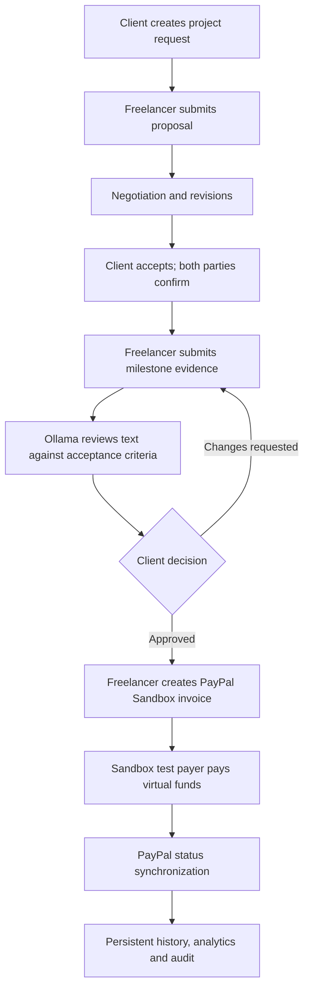
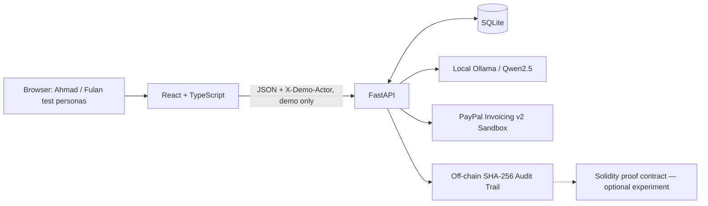

<div align="center">

# MilestonePay AI

### AI-assisted milestone commerce, with human decisions and verifiable Sandbox payments

**A transparent freelance project workflow powered by local AI and PayPal Sandbox**

[](LICENSE)


[Overview](#overview) · [Features](#features) · [Architecture](#system-architecture) · [Quick Start](#quick-start) · [Demo](#end-to-end-demo-walkthrough) · [Testing](#quality-assurance--testing) · [Security](#security--trust-boundaries) · [Roadmap](#roadmap)

**Built for the [PayPal AI Hackathon 2026](https://paypalaihackathon.devpost.com/)**

</div>

---

> [!IMPORTANT]
> **Local development and judging prototype — not a production financial service.** PayPal operations use **Sandbox virtual funds**, not real money. The current login screen selects test personas; the `X-Demo-Actor` request header is **not authentication**. There is **no custody, escrow, public-chain settlement, or live PayPal payment processing**. Do not expose the existing API to the public internet or supply PayPal Live credentials.

## Overview

**MilestonePay AI** is an experimental workspace for clients and freelancers to plan, negotiate, deliver, review, and invoice milestone-based projects through one traceable workflow. It brings together:

- Project requests, proposals, revisions, and negotiation.
- Bilateral agreements with explicit participant confirmation.
- Milestones with acceptance criteria, deadlines, and amounts.
- Local AI-assisted planning and text-evidence review using **Ollama + Qwen2.5**.
- **Human-in-the-loop** approval or rejection of deliverables.
- PayPal **Invoicing v2 Sandbox** creation, delivery, and provider-status synchronization.
- Persistent project, invoice, and audit records backed by **FastAPI + SQLite**.
- A bilingual (English/Indonesian) application interface on major screens.

The central principle is simple:

> **AI may advise. Humans approve work. PayPal reports payment status.**

This separation makes it possible to explain who made each decision and where each payment claim came from. MilestonePay does not claim that AI can independently determine whether real-world work was completed.

## The Problem

Freelance engagements can break down when requirements are vague, acceptance criteria are undocumented, work is judged subjectively, and payment updates are scattered across different tools. These problems can create avoidable revision cycles and disputes.

MilestonePay explores a more accountable process: define *what completion means* before work starts, collect evidence against those criteria, provide an AI-assisted second opinion, retain the human decision, and connect the approved milestone to an invoice whose status can be checked with PayPal.

**Intended users:** independent freelancers, individual clients, and hackathon evaluators. Commercial demand and real-user impact have **not yet been established by formal research**.

## How It Works



**Non-negotiable controls:** AI output does not automatically mark a milestone approved, invoice creation requires the relevant approval, and sending an invoice does not mean it has been paid.

## Features

| Area | What is available | Implementation / limitation |
| --- | --- | --- |
| Public landing page | Product introduction and entry points | Visitors can learn about the project before signing in |
| Sign-in card | Select Ahmad (client) or Fulan (freelancer) | **Demo persona selection**, not real identity verification |
| Account switching | Return to sign-in before selecting another persona | Clears the current frontend persona; does not secure the backend |
| Requests and proposals | Create/send requests, propose, negotiate, request revisions | Persistent FastAPI + SQLite workflow |
| Agreements | Accept proposal and collect confirmations from both parties | Not a legally reviewed digital-signature product |
| Milestone management | Define criteria, submit written evidence, approve/request changes | No independently verified file-deliverable system |
| AI planning | Suggest milestones and identify ambiguous requirements | Local Qwen2.5 responses are schema-validated and advisory |
| AI evidence review | Analyze supplied **text** against acceptance criteria | Does not inspect external files unless explicitly implemented |
| PayPal invoicing | Create, send and sync PayPal Sandbox invoices | Virtual funds only; server-side OAuth credentials |
| Dashboard and analytics | Persistent summaries, invoice history, CSV export | Cached status can be stale until synchronized |
| Audit trail | Per-project SHA-256 hash chain | Off-chain; not immutable external proof |
| Blockchain research | `contracts/MilestoneProof.sol` hash-only Solidity contract | **Contract source present; local anchoring deployment/UI not confirmed on `main`** |
| Localization | English and Indonesian on principal screens | Some technical/error messages may remain English |
| Sponsor experiments | Optional AG Grid code and exploratory sponsor ideas | Not a demonstrated sponsor integration unless enabled and tested |

## What Makes the Approach Different

1. **Human accountability:** the model assists with reasoning, but the client retains the final milestone decision.
2. **Criterion-linked evidence:** review is tied to acceptance criteria instead of a generic “looks done” response.
3. **Payment-source integrity:** the system distinguishes draft/sent invoices from a PayPal-confirmed `PAID` result.
4. **Local-first AI:** a small local model allows demonstrations without usage-based LLM API charges.
5. **Traceable workflow:** projects, invoices, AI reports, and audit events persist beyond a frontend reload.

These are design and implementation choices, **not verified claims of reduced disputes or improved productivity in production**.

## Technology Stack

| Layer | Technology | Responsibility |
| --- | --- | --- |
| Frontend | React 19, TypeScript, Vite 8, CSS | Landing page, persona gateway, workspace, analytics |
| Backend | Python 3.11, FastAPI, Pydantic | Business rules, workflow APIs, validation |
| Data | SQLite | Persistent projects, agreements, milestones, invoices and audit |
| AI | Ollama, Qwen2.5 3B | Structured planning and text-evidence analysis |
| Payments | PayPal REST OAuth, Invoicing v2 **Sandbox** | Create/send invoices and fetch authoritative status |
| Audit | SHA-256 | Detect modifications to locally linked audit events |
| Experimental Web3 | Solidity `MilestoneProof.sol` | Optional hash anchoring concept; no public deployment claimed |
| Quality | Pytest, TypeScript, Vite, Playwright, Python/PowerShell audits | Regression checks, browser checks, evidence reports |

## System Architecture



### Trust boundaries

- **Workflow authority:** FastAPI applies deterministic business-state and persona checks; however the persona header is caller-controlled and therefore **not production authorization**.
- **AI authority:** Ollama supplies advisory analysis, not payment or approval decisions.
- **Payment authority:** PayPal Sandbox is queried for invoice status; SQLite stores the last synchronized result.
- **Audit integrity:** SHA-256 linking can reveal simple modifications but a privileged database operator could rewrite the local chain. The Solidity contract does not establish public-chain immutability unless a deployment and anchor transaction are actually verified.

More details: [Architecture](docs/ARCHITECTURE.md) · [Security](docs/SECURITY.md) · [API reference](docs/API_REFERENCE.md).

## Repository Guide

```text
milestonepay-ai/
├── README.md                    # Project handbook
├── LICENSE                      # MIT
├── src/
│   ├── App.tsx                 # Landing page and sign-in card
│   ├── Workspace.tsx           # Navigation and workspace
│   ├── CommerceLab.tsx         # Project, AI and payment workflow
│   ├── LiveOverview.tsx        # Persistent dashboard
│   ├── InvoiceAnalytics.tsx    # Invoice analytics
│   └── api/commerce.ts         # Typed backend client
├── backend/
│   ├── app/
│   │   ├── main.py             # Workflow API
│   │   ├── commerce.py         # AI, invoicing and audit endpoints
│   │   ├── ai_service.py       # Local model adapter
│   │   └── paypal.py           # Sandbox-only PayPal adapter
│   ├── tests/                 # Pytest regression suite
│   ├── requirements.txt
│   └── .env.example
├── contracts/
│   └── MilestoneProof.sol      # Experimental hash-only smart contract
├── docs/                       # Architecture, API, security and submission docs
├── scripts/                    # Release checks and evidence tools
└── sponsors/                   # Optional sponsor experiments
```

Some local upgrades may add `blockchain/`, `src/BlockchainAudit.tsx`, or `backend/app/blockchain_routes.py`; these are **not assumed to exist on the default GitHub branch**. Do not document them as deployed until their installation and tests have been verified.

## Quick Start

### Requirements

- Windows PowerShell (commands below), Git, and a current Node.js/npm version compatible with Vite 8.
- Python **3.11** recommended (the documented local tests used Python 3.11.9).
- [Ollama](https://ollama.com/) for real local inference and the `qwen2.5:3b` model.
- PayPal Developer **Sandbox** credentials for invoice creation and status synchronization.

### 1. Clone and install

```powershell

git clone https://github.com/MENSTRUE/milestonepay-ai.git
cd milestonepay-ai
npm install

cd backend
py -3.11 -m venv .venv
.\.venv\Scripts\python.exe -m pip install -r requirements.txt
Copy-Item .env.example .env
cd ..
```

> **Existing local checkout?** Preserve your current `backend/.env` and `backend/milestonepay.db`. Do not replace or delete them when updating source code. Never commit either file.

### 2. Configure the backend

Edit `backend/.env` locally:

```dotenv
AI_PROVIDER=ollama
OLLAMA_BASE_URL=http://127.0.0.1:11434
OLLAMA_MODEL=qwen2.5:3b

# PayPal Sandbox only; obtain values in your PayPal Developer Sandbox account
PAYPAL_CLIENT_ID=
PAYPAL_CLIENT_SECRET=
PAYPAL_MERCHANT_EMAIL=
PAYPAL_BASE_URL=https://api-m.sandbox.paypal.com
```

Do **not** put API secrets in `src/`, screenshots, Git commits, demo videos, or public issue reports. The frontend does not need PayPal credentials.

### 3. Start the services

Open separate terminals:

**Terminal A — Ollama**

```powershell
ollama pull qwen2.5:3b
# Run 'ollama serve' only when the Ollama server is not already active.
ollama serve
```

**Terminal B — FastAPI**

```powershell
cd milestonepay-ai\backend
.\.venv\Scripts\python.exe -m uvicorn app.main:app --reload --host 127.0.0.1 --port 8000 --env-file .env
```

**Terminal C — React/Vite**

```powershell
cd milestonepay-ai
npm run dev
```

| Service | Local URL |
| --- | --- |
| Web application | http://localhost:5173 |
| FastAPI documentation | http://127.0.0.1:8000/docs |
| FastAPI OpenAPI JSON | http://127.0.0.1:8000/openapi.json |
| Ollama (local service) | http://127.0.0.1:11434 |

> The shell commands assume terminals are opened in the parent directory of the cloned repository. Adjust paths if you are already inside the project directory. If Ollama is already running, do not start another server on the same port.

## End-to-End Demo Walkthrough

The application uses two predefined **test personas**:

| Display name | Internal API actor | Role |
| --- | --- | --- |
| Ahmad | `jordan` | Client |
| Fulan | `alex` | Freelancer |

1. Open the **public landing page**, then click **Sign In**.
2. Select **Ahmad** and explicitly enter the workspace.
3. Create and send a project request with a budget, description, and expected outcome.
4. Click **Switch Account**. The application must return to the **sign-in card** before Fulan can be selected.
5. Select **Fulan**, negotiate if needed, and submit a milestone-based proposal.
6. Return through the sign-in card to **Ahmad**; accept the proposal. Both personas confirm the agreement.
7. As **Fulan**, submit textual milestone evidence.
8. Run the optional **AI review**. Explain the findings and uncertainty rather than treating them as proof.
9. As **Ahmad**, approve the work or request changes manually.
10. For an approved milestone, use **Fulan** to create and send a **Sandbox invoice**. Pay with a separate Sandbox payer account.
11. Sync the invoice status from PayPal. Display `PAID` only when PayPal reports it.
12. Inspect the dashboard, invoice analytics, CSV export, and audit history. Use **Log out** to return to the landing page.

### Demonstrated transaction

In the developer's existing local test environment, a **USD 450.00 PayPal Sandbox invoice** previously reached `PAID` after an actual Sandbox test payment and provider synchronization. It represents **virtual test funds**. This record belongs to that local SQLite database; a fresh Git clone does **not** come with a paid invoice.

## AI Design: Recommendations, Not Autonomy

AI planning and evidence review run locally through Ollama and produce structured output validated against Pydantic schemas. Planning focuses on requirement ambiguities and candidate milestones; review maps submitted text to acceptance criteria, which may be classified as **Supported**, **Partially Supported**, **Not Demonstrated**, or **Needs Human Review**.

Important limitations:

- AI does **not** independently verify real-world completion, attached files, or external URLs in the current tested workflow.
- AI does **not** accept proposals, approve milestones, create payment obligations, or mark invoices paid on its own.
- Business rules and human decisions remain separate from model generation.
- Model output may be inaccurate and needs review, especially for ambiguous evidence.

This is a **bounded AI-assisted workflow**, not a claim of a fully autonomous multi-agent financial system.

## PayPal Sandbox Integration

The backend uses server-side OAuth credentials to call **PayPal Invoicing v2 Sandbox**. The main actions are:

1. **Create invoice** for an eligible, approved milestone.
2. **Send invoice** to a Sandbox test payer.
3. **Synchronize status** from the PayPal API and persist the result.
4. **Read invoice history** from SQLite for the two project participants.

**Sending an invoice is not the same as payment.** A locally cached `PAID` record should be distinguished from a fresh provider sync. The prototype does not provide PayPal Live processing, escrow, payout custody, or financial advice.

## Audit Trail and Experimental Blockchain

**Available today:** per-project audit events linked with SHA-256 hashes in SQLite. The API checks whether the recorded chain remains internally consistent.

**Experimental:** the repository includes `contracts/MilestoneProof.sol`, a Solidity proof-of-concept for recording **hashes only**. It is not an escrow contract, and it never transfers funds. A local Hardhat deployment/anchor integration may be developed and tested separately, but the presence of a Solidity file **does not establish a deployed smart contract or verified on-chain transaction**.

Before claiming blockchain integration in a demo, verify the contract address, deployed network, transaction receipt, block number, and successful read-back against the intended audit digest. A local development chain is resettable and should not be represented as independently permanent public-chain evidence.

## API Reference

The backend offers interactive OpenAPI documentation at `/docs`. Selected routes include:

| Method | Path | Purpose |
| --- | --- | --- |
| `GET` | `/api/v1/health` | Service/integration configuration health |
| `GET`, `POST` | `/api/v1/requests` | List or create project requests |
| `POST` | `/api/v1/requests/{id}/send` | Send a request |
| `GET`, `POST` | `/api/v1/requests/{id}/proposals` | Retrieve or create a proposal |
| `POST` | `/api/v1/requests/{id}/proposals/revise` | Revise proposal |
| `GET`, `POST` | `/api/v1/requests/{id}/negotiations` | Read/create negotiation entries |
| `POST` | `/api/v1/requests/{id}/proposals/accept` | Accept proposal |
| `GET` | `/api/v1/requests/{id}/agreement` | Read agreement |
| `POST` | `/api/v1/requests/{id}/agreement/confirm` | Confirm agreement |
| `GET` | `/api/v1/requests/{id}/milestones` | List milestones |
| `POST` | `/api/v1/requests/{id}/milestones/{milestone_id}/submit` | Submit milestone evidence |
| `POST` | `/api/v1/requests/{id}/milestones/{milestone_id}/review` | Human milestone decision |
| `POST` | `/api/v1/agent/plan` | Generate AI milestone plan |
| `POST` | `/api/v1/agent/review` | Request AI evidence analysis |
| `POST` | `/api/v1/paypal/invoices` | Create Sandbox invoice |
| `POST` | `/api/v1/paypal/invoices/{invoice_id}/send` | Send Sandbox invoice |
| `GET` | `/api/v1/paypal/invoices/{invoice_id}/sync` | Fetch PayPal status and update cache |
| `GET` | `/api/v1/requests/{id}/invoices` | Invoice history |
| `GET` | `/api/v1/requests/{id}/audit` | Audit chain and integrity check |

> All current actor-sensitive routes use `X-Demo-Actor: jordan` or `X-Demo-Actor: alex` for the **local demo only**. The header is not a secure authentication mechanism. For full request/response schemas, consult [API_REFERENCE.md](docs/API_REFERENCE.md) or the running FastAPI Swagger UI.

## Quality Assurance & Testing

The project includes several layers of local verification:

| Layer | Tooling | What it checks |
| --- | --- | --- |
| Type safety | TypeScript | React/API type compatibility |
| Build | Vite | Production frontend compilation |
| Backend regression | Pytest | Workflow, permissions, invoice mock behavior and safety rules |
| API smoke checks | Python | Health, persona validation, invoice and audit snapshots |
| Browser E2E | Playwright | Landing, login gate, account switch, locale, analytics, reload and logout |
| Release audit | PowerShell + Python | Sensitive files, documentation, SQLite snapshot and local services |

### One-command checks

```powershell
# From the repository root
.\scripts\release_audit.ps1

# If the optional E2E upgrade has been installed:
.\scripts\evidence_gate.ps1

# If the optional local blockchain upgrade has been installed:
.\scripts\blockchain_check.ps1
```

The E2E/blockchain scripts should only be invoked if their respective overlay has been installed; they are **not guaranteed to exist on an untouched clone of `main`**.

### Latest reported local verification (before blockchain overlay)

The project developer reported the following successful local results:

- **7/7** backend regression tests.
- **11/11** read-only API smoke checks.
- **8/8** Chromium browser E2E assertions.
- TypeScript check, Vite production build, and local source/security audits passing.
- An existing locally stored Sandbox invoice of **USD 450.00** marked `PAID`.

These are **local development observations**, not a public CI badge, production security certification, independent PayPal reconciliation audit, or verification that all optional Web3 components are deployed.

Test reports and screenshots can contain identifying details; review and redact them before publishing.

## Security & Trust Boundaries

| Topic | Current status / requirement |
| --- | --- |
| Authentication | Demo persona gateway only; **no real user authentication** |
| API authorization | Demonstration-level actor checks; do not publicly expose |
| Credentials | Server-side `.env`; excluded from Git |
| Payments | Sandbox-only virtual funds; no production money movement |
| AI | Human-reviewed advisory output; no autonomous approvals |
| Audit | Local tamper-evident hash chaining, not immutable external storage |
| Data privacy | No production-grade user privacy or retention policy implemented |
| Deployment | Designed for localhost; requires substantial hardening before public use |

**Production blockers:** real identity and session management, tenant isolation, strong backend authorization, secure file storage, webhook-driven/idempotent payment reconciliation, abuse prevention, rate limits, privacy controls, operational monitoring, secure deployment, and compliance/legal review where necessary.

See [SECURITY.md](docs/SECURITY.md) for more.

## Roadmap

### Proven MVP foundation

- [x] Persistent request/proposal/agreement/milestone workflow.
- [x] Bounded local AI planning and evidence review.
- [x] PayPal Sandbox invoice creation and status synchronization.
- [x] Bilingual core UI, dashboard and invoice analytics.
- [x] Demo-persona login gate and automated browser/API tests.
- [x] Off-chain SHA-256 audit trail.

### Validation and near-term improvements

- [ ] Re-verify fresh Ollama inference and PayPal status in the final screen-recorded run.
- [ ] Complete a public **under-three-minute** English demo video and hackathon submission.
- [ ] Gather real user feedback and document usability findings.
- [ ] Add continuous integration and coverage reports.
- [ ] Validate local blockchain deployment, anchoring, and read-back; publish accurate proof if completed.
- [ ] Enable and demonstrate sponsor components only when they materially improve the product.

### Long-term, production-oriented research

- [ ] Real authentication and secure multi-user authorization.
- [ ] True multi-tenant isolation, database migrations, and reliable deployment.
- [ ] Secure attachment verification and better evidence provenance.
- [ ] Webhooks, reconciliation, idempotency, and production payment safety controls.
- [ ] Independent security and privacy review.

## Hackathon Submission

This project was built for the **PayPal AI Hackathon 2026**.

- **Deadline:** November 12, 2026 at 12:00 PM Pacific Standard Time (**November 13, 2026 at 03:00 WIB**).
- **Core demonstration:** milestone-based AI-assisted commerce + PayPal Sandbox invoice synchronization.
- **Code:** public repository with an open-source [MIT License](LICENSE).
- **Video:** prepare a public YouTube video **shorter than 3 minutes**, with English narration/captions.
- **Demo availability:** either a functioning hosted demo or sufficiently complete local setup instructions.

**Submission assets:** [English Devpost draft](docs/DEVPOST_SUBMISSION_EN.md) · [Video script](docs/VIDEO_DEMO_SCRIPT_EN_FINAL.md) · [Manual QA checklist](docs/FINAL_QA_CHECKLIST.md) · [Release readiness](docs/RELEASE_READINESS.md).

Official references: [Hackathon page](https://paypalaihackathon.devpost.com/) · [Competition rules](https://paypalaihackathon.devpost.com/rules).

No win, shortlist, sponsor-prize eligibility, or independent judge endorsement is implied by passing local tests.

## Contributing

Issues, carefully scoped pull requests, documentation improvements, and reproducible bug reports are welcome. Please:

1. Explain the expected and actual behavior and provide reproduction steps.
2. Add or update regression tests when changing workflow or payment behavior.
3. Redact tokens, account emails, invoice IDs, and personal data from logs/screenshots.
4. Preserve the Sandbox-only boundary unless a separate secure production architecture is explicitly developed.

## License and Disclaimer

Released under the [MIT License](LICENSE). Third-party service names and trademarks remain the property of their owners. MilestonePay AI is an independent hackathon project and is **not endorsed by, operated by, or affiliated with PayPal**.

---

<div align="center">

**MilestonePay AI** · *Clear expectations. Human accountability. Verifiable Sandbox payment status.*

[Back to top](#milestonepay-ai)

</div>
