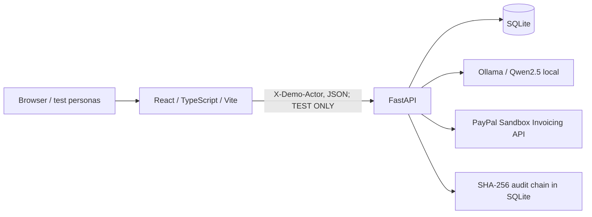
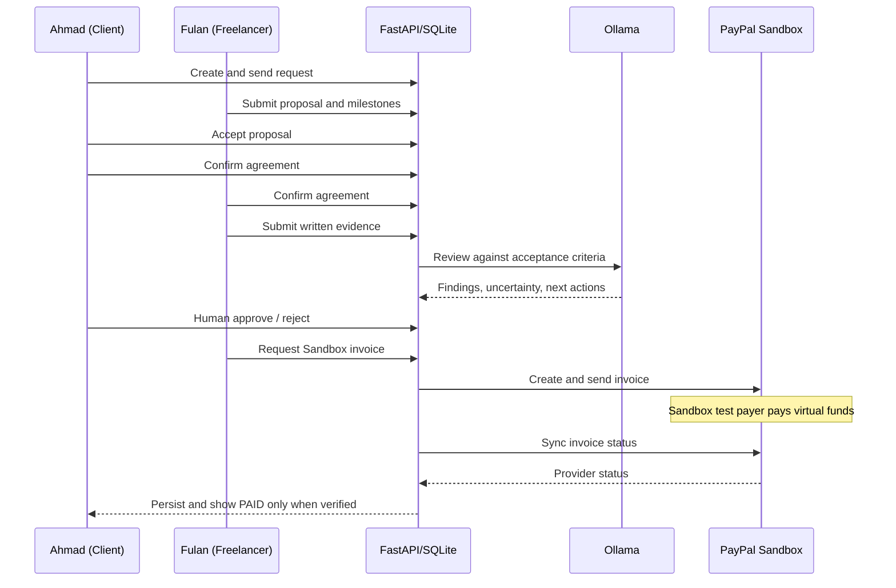

# MilestonePay AI — Architecture / Arsitektur

## Design goals / Tujuan

- Persistent, reviewable milestones: all committed project and invoice facts reside in SQLite, not fabricated React state.
- Human approvals: local LLM advice does not override client or provider decisions.
- PayPal Sandbox as payment-status authority: issuance and sending are distinct from payment.
- Local-first judging demo: the FastAPI service and Ollama run on the developer's machine.

## System map / Peta sistem

## Core layers / Lapisan utama

| Layer | Representative source | Role |
|---|---|---|
| Public landing and persona sign-in | `src/App.tsx` | Landing, login card, session-scoped test persona selection |
| Workspace/navigation | `src/Workspace.tsx` | Bilingual navigation, dashboard, test account switching |
| Workflow UI | `src/CommerceLab.tsx` | Request, negotiation, proposals, agreements, AI and payment views |
| Analytics UI | `src/InvoiceAnalytics.tsx` | Invoice history and CSV output |
| API client | `src/api/commerce.ts` | Typed JSON calls with demo actor header |
| Business endpoints | `backend/app/main.py` | Requests, proposals, agreements, milestone permissions |
| Commerce endpoints | `backend/app/commerce.py` | AI, invoices and audits |
| AI adapter | `backend/app/ai_service.py` | Ollama calls and validation of AI results |
| PayPal adapter | `backend/app/paypal.py` | Sandbox OAuth and Invoicing v2 calls |
| Automated safety tests | `backend/tests/` | Isolated mocked workflows and permission checks |

## User action sequence / Urutan kerja

## Data responsibility / Tanggung jawab data

- **Authoritative project state:** SQLite, via FastAPI. / Status proyek berasal dari database.
- **AI analysis:** suggestions, structured and validated but not proof of actual delivery. / Analisis AI adalah saran.
- **Payment status:** PayPal Sandbox API after synchronization, cached in SQLite. / Status pembayaran disinkronkan dari PayPal.
- **Audit:** local hash chain, detectable if modified, but privileged access could rewrite history; no external notarization. / Jejak audit belum memiliki jangkar eksternal.

## Known architectural limitations / Batasan

1. `X-Demo-Actor` is controllable by the caller; it is **not authentication**. / Header ini bukan autentikasi.
2. A browser login card is not a server-side session. / Form login tidak sama dengan sistem autentikasi backend.
3. The LLM performs structured planning/review, **not** independently orchestrated financial decisions. / AI belum menjadi agen otonom untuk keputusan finansial.
4. SQLite and in-process local services simplify the demo; a multi-user deployed architecture needs migration, durable storage, isolation, concurrency and operations work.
5. Current payments are Sandbox virtual money. No production escrow, payouts, custody or live transfer is implemented.

## Deployment boundary / Batas deployment

For local demo only: React 5173, FastAPI 8000 bound to `127.0.0.1`, Ollama 11434 bound to loopback. Never publish the current FastAPI service directly or use Live PayPal credentials. For judging, prefer complete reproducible local setup instructions until real auth and deployment hardening are done.
